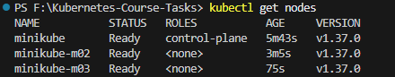
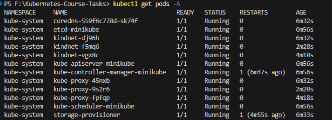
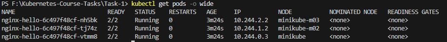
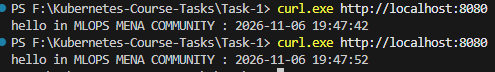
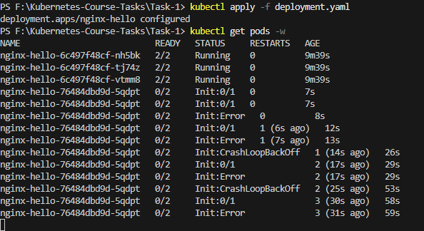
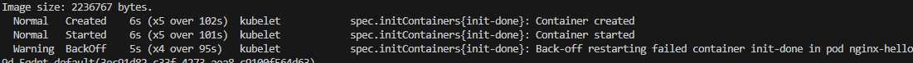
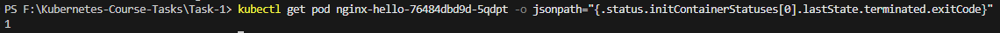

### 3-Node Minikube Cluster

### Kubernetes System Pods

### Application Pods Distributed Across the Cluster

### Timestamp Updates Served by Nginx

### Init Container Failure and Pod Lifecycle

### Diagnosing the Init Container Failure

### Verifying Init Container Exit Code 1

